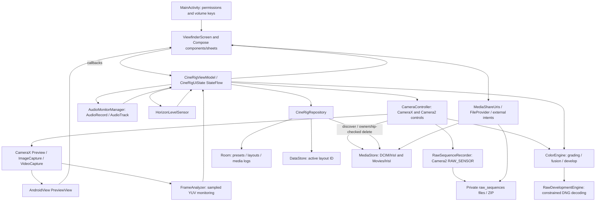

# IrisI — Design Readiness Report

**Audit date:** 2026-11-16. **Scope:** source inspection, build/test verification, limited current UI observation, and official Penpot/OpenCode documentation review. No redesign, application-source/configuration edits, dependency installation, or Penpot installation/configuration was performed.

Supporting deliverables:
- [Screen inventory](audit/SCREEN_INVENTORY.md)
- [Feature implementation matrix](audit/FEATURE_STATUS.md)
- [Penpot MCP readiness](audit/PENPOT_MCP_READINESS.md)
- [Current screenshots and provenance](audit/current_ui_screenshots/README.md)

## 1. Executive summary

IrisI is a real, offline, native Android camera application—not a static prototype. It contains CameraX/Camera2 capture, manual sensor controls, encoded video recording, experimental sequential DNG capture, image processing, a local media library, photo development, saved camera presets, and customizable HUD layouts. A complete native Compose visual redesign is feasible without replacing those engines.

**Readiness verdict: ready for evidence-led design planning; not ready for an unqualified “all professional camera features work” claim.** Preserve the workflows, but distinguish a requested setting, reported device capability, successfully negotiated pipeline, and actual recorded output. Several professional-looking controls describe approximations or conditional capabilities.

The most important design work is information hierarchy: a larger useful viewfinder, less duplicated chrome, legible compact controls, clear recording/processing states, and honest availability/output descriptions. This is not a request for decorative dashboard screens, account onboarding, social features, or a new app framework.

**Verification:** default Java 11 could not run Gradle; process-local Android Studio JBR resolved that without project edits. Offline debug assembly succeeded. A fresh `:app:testDebugUnitTest --rerun-tasks` run succeeded: **36 tests, zero failures/errors/skips** across nine suites. Instrumentation, lint, release signing, sustained capture, and camera-output fidelity were not freshly verified in this audit. Build warnings included missing optional `google-services.json` (configured WARN), a redundant condition, and a deprecated Camera2 capture-session API.

Current Pixel discovery established Android 17/API 37, 1080×2340, 420 dpi and matching installed/local APK hashes. IrisI subsequently launched successfully and one initial screenshot was captured. Wireless ADB was intermittent and the phone was actively being used, so further physical-device interaction stopped. The existing API 37 emulator supplied current permission, camera UI, manual-deck, color-workbench, settings, hardware, presets and customizer captures. These prove UI reachability, not physical capture quality.

## 2. Technology and build

| Area | Observed implementation / evidence |
|---|---|
| Product identity | Display/root name IrisI; namespace/source `com.example`; application ID `com.aistudio.cinerig.vxkpmq`; version 1 / 1.0 |
| Platform | Kotlin, Android application module `app`, Jetpack Compose + Material 3; `app/build.gradle.kts` |
| SDKs | min 24, target 36, compile 36.1; Java source/target 11 is distinct from Gradle's Java 17+ runtime requirement |
| Build | AGP 9.1.1, Gradle 9.3.1, Compose compiler plugin 2.2.10, KSP 2.3.5; versions in `gradle/libs.versions.toml` |
| UI dependencies | Compose BOM 2024.09.00, Material icons, lifecycle Compose, Coil 2.7.0 |
| Capture | CameraX 1.5.0 camera2/core/extensions/lifecycle/video/view plus direct Camera2 RAW workflow |
| Data | Room 2.7.0; preferences DataStore 1.1.7; coroutines 1.10.2; MediaStore and private files |
| Navigation | No active Navigation Compose dependency; enum-driven panels in one screen |
| Networking/auth | No INTERNET permission. Firebase/auth/Retrofit/OkHttp catalog entries or commented dependencies are not implemented app functionality |
| Variants | Debug and release; no product flavors observed; release minification disabled; release keystore/passwords depend on environment |
| Plugins | Google services plugin active with missing-file WARN; secrets plugin reads `.env` / `.env.example`. Neither establishes a backend feature |

Entry point: `app/src/main/java/com/example/MainActivity.kt:25` uses `enableEdgeToEdge`, `CineRigTheme`, lifecycle-aware state collection, permission launcher, and `ViewfinderScreen`. Volume keys dispatch through `CineRigViewModel.handleVolumeKey`.

Reproduction (existing local JBR/SDK; no download):

```powershell
$env:JAVA_HOME = 'C:\Program Files\Android\Android Studio\jbr'
$env:ANDROID_HOME = "$env:LOCALAPPDATA\Android\Sdk"
.\gradlew.bat :app:assembleDebug --no-daemon --offline
.\gradlew.bat :app:testDebugUnitTest --no-daemon --offline --rerun-tasks
```

`audit/build-verification.log` retains the final assembly output. Fresh unit-test XML remains in `app/build/test-results/testDebugUnitTest/`. An initial up-to-date test task was not treated as fresh execution; the subsequent rerun actually executed the tasks. This is not a clean-machine or clean-build proof.

## 3. Implemented features and boundaries

See [the full matrix](audit/FEATURE_STATUS.md) for classifications and exact source anchors. Key distinctions:

- **Photo:** JPEG and hardware-conditional DNG/RAW+JPEG paths are implemented. Burst, AEB fusion, focus-stack fusion, interval capture, and night stacking have processing code, not just buttons. Their image quality, alignment, metadata, throughput and device coverage remain qualified.
- **Video:** CameraX MP4 start/stop/pause/resume, duration/size state, mic enablement, output-quality requests and geometry validation are implemented. “Log Monitor MP4” is monitoring-only, not a proven sensor-log encoding pipeline; codec choice remains device-selected.
- **DNG sequence:** direct Camera2 `RAW_SENSOR` workflow saves sequential DNGs and a ZIP. ViewModel requests at most 10 fps, 10 seconds and 60 frames; no audio or cinema-rate encoded RAW movie is implied. CameraX surfaces are released during this workflow, so continuous live preview/analysis must not be promised.
- **Manual controls:** ISO/shutter/focus/WB/EV/zoom/flash are wired. Priority exposure is an app-side luma heuristic, not proof of OEM metering equivalence. Hardware bounds and control support require accurate gating.
- **Monitoring:** histogram, peaking, loupe, zebras, false color, horizon and guides are wired. The “waveform” is column-average luma; “RGB parade” draws channel histograms, not a professional spatial RGB waveform. Scopes analyze sampled YUV upstream of the display look, not guaranteed graded or encoded output.
- **Audio:** preview metering, device preference, digital monitor trim and headphone loopback exist. Preview capture/loopback is stopped for CameraX recording. Digital trim is not wired into encoded recording gain, the two displayed bars are not independent stereo measurement, and “Zero-Latency” is unsupported wording.
- **Library/develop:** local discovery/logs, filters, search, favorite, sharing, metadata, delete, image development and JPEG copy export exist. External intents provide viewing/playback; there is no native fullscreen image/video viewer. RAW development supports a constrained custom DNG decoder, not a fully calibrated professional RAW pipeline.
- **Presets/HUD:** Room-backed presets and layouts, zone/order changes and Fn/volume bindings exist. Presets are snapshots of selected fields, not universal capture-session backups.

No account, cloud sync, social feed, AI service or remote collaboration workflow is implemented in the app. Do not add those screens merely to make the redesign look comprehensive.

## 4. Navigation and information architecture

`CineRigViewModel.kt:40` defines `ActiveSheet`: `NONE`, `COLOR_GRADE`, `VIDEO_STAB`, `AUDIO_MONITOR`, `UI_CUSTOMIZER`, `PRESETS`, `VAULT`, `DEVELOP`, `HARDWARE_INFO`. The enum is state, not a navigation back stack or deep-link graph.

`ViewfinderScreen.kt:323–389` dispatches sheet content. Color grading is **inline** in the console, not a dimming modal. Photo/Video/Night/DNG SEQ are capture modes of the same screen, not four independent destinations. Hardware can be opened from the top HUD or mode settings. Library is called `VAULT` internally. Develop receives a selected media entity.

Back closes the active sheet first, then layout edit mode (`ViewfinderScreen.kt:112`). An important inconsistency: Develop's supplied dismiss callback opens the library, while the outer BackHandler generically closes to `NONE`; validate physical/system Back behavior rather than assuming identical returns. Settings-to-Hardware replaces the enum value; there is no preserved settings stack.

Permission gate precedes camera content. First launch automatically requests CAMERA and RECORD_AUDIO together (`MainActivity.kt:43–62`); camera permission alone is sufficient for the main UI. Permanently denied/revoked/settings-return behavior needs explicit design and runtime validation.

**Design implication:** define a small camera-first hierarchy with Capture, Mode Settings, Monitoring/Audio, Looks, Library/Develop, and Presets/Customize. This is a proposed grouping, not current navigation or authorization to implement it.

## 5. Current UI and runtime inventory

The detailed [inventory](audit/SCREEN_INVENTORY.md) lists entry points, controls, states, and screenshot coverage. Current captures are in `audit/current_ui_screenshots/`; paired XML exposes the observed accessibility tree. Fullscreen images must be reviewed at their original dimensions, not inferred from scaled previews.

Portrait uses a top HUD, weighted aspect-constrained preview, lens/zoom row, mode-specific quick controls, manual deck, mode selector and capture controls. Landscape uses a preview region and a **fixed 324.dp** scrolling side console (`ViewfinderScreen.kt:194–249`). The preview container is aspect-fit with rounded corners; `PreviewView` uses `FILL_CENTER`. Composition, preview crop and recorded-output crop are related but not interchangeable.

Useful existing foundations: a prominent 70.dp shutter, labeled mode switching, source-level recording tally/pause controls, close/dismiss paths, state-driven HUD, polite live-region camera error and monitoring notices, offline media ownership restrictions, and source-provided test tags.

Observed/source-grounded weaknesses: many capsule/border surfaces compete with the preview; duplicated settings across quick strips/HUD/sheets; dense 9–11sp telemetry; 28–40dp custom controls; horizontally hidden options; modal content starting half-height and extending below the screen; gesture-heavy color adjustment; fixed Develop preview height. Larger font, TalkBack, switch access, foldables, small landscape widths, and OEM navigation insets were not verified.

Not captured now: all Video/Night/DNG states, active recording/paused/finalizing, successful/failed exports, populated/empty library, EXIF and share chooser, all customizer tabs, direct-edit move dialog, full sheet scroll ranges, landscape, permanent permission denial, camera recovery, and headset routing. Absence of a screenshot is not absence of implementation.

## 6. Design system audit

Source of truth today:

| Concern | Actual source / current values |
|---|---|
| Colors | `ui/theme/Color.kt`: amber `#E6A954`, background `#0E0F12`, surface `#141519`, text `#ECEEF2`, secondary text `#AEB5C2`, cyan `#6BB8D6`, record/error red `#E54D4D` |
| Material roles | `ui/theme/Theme.kt:13–40` maps custom palette into `darkColorScheme` |
| Dynamic color | `CineRigTheme(useDynamicColor=false)` default; optional API31+ dynamic dark accents exist, but activity does not enable them |
| Shapes | `CineRigShapes`: 8/12/18/24/32.dp; many components bypass these with inline 10/14/16/18/24.dp radii and circles |
| Typography | `ui/theme/Type.kt`: Space Grotesk headings, Inter body, JetBrains Mono telemetry; display 28sp, headline 20sp, title 16/13sp, body 15/13/11sp, labels 13/11/10sp |
| Overrides | Manual telemetry and dials explicitly use 9sp; manual program and other captions use 10sp |
| Spacing | Inline dp values throughout; no coherent shared spacing/density scale |
| Icons | Material rounded icons plus IrisI aperture vector; many labels remain hardcoded English despite string resources |
| Motion | Animated visibility, spring aspect/shutter changes, animated colors; no documented motion/reduced-motion contract |

**Assessment:** a partial code design system exists, not an absent theme. Its reuse is incomplete. There is no demonstrated Penpot-token-to-Compose synchronization or component spec covering all interaction states.

Recommended direction, not an implemented redesign: restrained Material 3/Material You, neutral dark preview surround, semantic record/error/monitor colors retained regardless of wallpaper, one clear primary shutter action, compact but accessible controls, and progressive disclosure of specialist tools. “Compact” must not mean 28dp hit targets or 9sp critical readings. Use native sliders/chips with proper roles and values; custom dials require adjustable accessibility actions and a non-gesture alternative.

Token handoff should define semantic roles, typography/line heights, spacing, radii, icon sizes, minimum interactive targets, preview-safe margins, state colors and motion. Penpot pixels are design units, not automatically Android px or dp; document density assumptions and verify on actual screens.

## 7. Architecture and data flow

Paths in this section are under `app/src/main/java/com/example/` unless stated otherwise.



- `CineRigViewModel` is an `AndroidViewModel` owning controllers/repository and combining many streams. It also manages timers, session rebinding, preset serialization, export and library mutations; there is no demonstrated DI/domain-use-case separation.
- `CameraController.bindCameraSession`, `applyCamera2ManualControls`, `capturePhoto`, `toggleVideoRecording`, `toggleRawSequenceRecording` implement hardware interactions. These are preservation boundaries, not UI substitutes.
- `FrameAnalyzer` throttles around 65ms, samples/downsizes monitoring output, and uses `AnalysisGeneration` to discard obsolete results. CameraX binding can retry without analysis to preserve encoded resolution; UI notices communicate this tradeoff.
- `ColorEngine.buildColorMatrix` is an approximate live look. `applyGradingToBitmap` / `applyDevelopToBitmap` add processing not fully represented by that matrix. Do not design a precision “what you see is exactly what is encoded” promise.
- `CineRigDatabase.kt` is Room version 3 with destructive migration fallback. Tables are defined in `data/local/Entities.kt`; DAO and repository expose flows. DataStore currently persists active layout selection, not the complete transient UI/camera session.
- `CineRigRepository.discoverOwnedMedia` limits discovery to app-owned output folders on API29+; it is not an arbitrary device gallery. FileProvider is non-exported with temporary grants; `MediaShareUris` resolves owned private outputs for single sharing.

**Presentation changes can preserve engines**, but moving/remounting `AndroidView`, changing preview geometry, altering lifecycle collection, losing callback ordering or replacing capture-state checks can break functionality. Enum names stored in Room/JSON and saved bindings are compatibility contracts even if visible labels change.

## 8. Penpot MCP integration readiness

**Not configured; connection and design-file operations UNVERIFIED.** OpenCode v2.3.0 and existing MCP tools are present, but that is not evidence of a Penpot connection. Global MCP configuration inspected at `C:\Users\tawhi\.config\opencode\opencode.json` contains `node_repl` and `rea`, not Penpot. Existing credential values are intentionally excluded from this report. Claude CLI was not on PATH; that does not establish whether any Claude desktop application is installed.

Official documentation confirms hosted and local Penpot MCP, layout/component/style inspection, Plugin API-based design mutation, and asset export. Local exposes `execute_code`, `high_level_overview`, `penpot_api_info`, `export_shape`, `import_image`; remote lacks local-path import and direct local-path export. Token operations and API coverage must be checked in the connected version, not assumed to be perfect bidirectional synchronization.

Hosted Penpot requires enabling MCP under account Integrations, generating a personal MCP key, configuring the provided Streamable HTTP URL, and connecting a design file through File → MCP Server → Connect. Local mode additionally requires a version-compatible Node/npm server, plugin manifest and live plugin connection. No setup was executed. See [readiness details](audit/PENPOT_MCP_READINESS.md), including safe illustrative V2 config and validation gates.

Penpot cannot directly manipulate CameraX, validate DNG quality, execute Android camera tests, or automatically generate production-quality native Compose from HTML/CSS. Its role here is structured design context, tokens/assets and handoff; Android implementation still requires engineering and device verification.

## 9. Recommended design-to-code workflow

1. Approve this inventory and resolve technical labels/availability promises before high-fidelity design.
2. Decide hosted versus local Penpot and privacy boundaries. Keep MCP tokens, personal photos and sensitive screenshots out of the repository and shared design files.
3. After separate authorization, connect MCP and run read-only file/page/component/token queries first. Confirm the active tab/page identity; keep the plugin/tab awake. Do not test connection by making unapproved edits.
4. Model the existing camera modes, sheets, recording/processing/denied/unavailable states and orientation variants. Include actual failure and output-negotiation states, not only attractive happy paths.
5. Agree semantic tokens and component-to-Compose mappings. Preserve hardware callback contracts, persistence keys and capture invariants. Use reusable Compose components, not flattened full-screen image exports.
6. Review flows against this feature matrix. Approve the design scope before implementation; Penpot write permissions are not authorization to modify app code or every design page.
7. Implement a separately authorized presentation-only slice, then compare screenshots on emulator and physical hardware at normal and large font sizes, portrait/landscape and gesture/three-button navigation.
8. Re-run unit/UI tests and inspect actual photo/video/RAW outputs. Verify recording pause/finalize, background/rotation recovery, unavailable settings, mic denial, sharing, owned-media deletion and export errors. Retain before/after evidence and document behavior changes.

## 10. Complete redesign scope and preservation checklist

Design coverage must include:
- Permission rationale/request/retry/permanent denial and camera-not-available recovery.
- Photo, Video, Night and experimental DNG sequence camera shells, useful preview framing, lens switching and zoom.
- Collapsed/expanded manual deck: AUTO/P/S/ISO/M, EV, ISO, shutter/180°, focus/AF/MF, WB; focus tap/lock feedback and monitor overlays.
- Mode-specific quick controls, shutter/timer/interval/night-stack progress, video recording/paused/stopping/finalizing, RAW preparing/capturing/archiving/rebinding.
- Photo and video settings, hardware constraints/storage, scopes/false-color legend, audio routing/gain/monitoring and denied/unavailable states.
- Inline color workbench: dials, color pad, finish controls, stocks/grain, video Log/LUT and compare/bypass.
- Library empty/populated/search/filter/favorite/multi-select, metadata, external viewing/share handoff, delete safety, missing/stale URI and discovery failure.
- Develop loading/decode failure/unsupported RAW, Tone/Color/Film-Export tabs, compare/rotation/reset and export busy/success/failure.
- Presets list/save/apply/delete; customizer layout selection/save/delete, arrangement/order/hidden zones, Fn and hardware-key assignments, live-edit zone dialog.
- Reusable bottom sheets/dialogs, typography, accessibility semantics, consistent target sizing and landscape/adaptive variants.

Out of scope unless separately requested: accounts, social/cloud/marketing screens, decorative glass/neon/3D chrome, new backend, capture-engine replacement, generalized gallery import and invented professional codec capabilities.

## 11. Ten ranked design problems

Ranking is reviewer judgment based on source and limited current observations, not measured user research. **V** = visual/information design; **F** = functional/state truth; **A** = accessibility.

| Rank | Type / severity | Problem and evidence | Required design response |
|---|---|---|---|
| 1 | F / critical | Displayed request can be mistaken for proven output. `CameraController.bindCameraSession`, settings and format badges; historical requested-4K/actual-1080 discrepancy later repaired with guards | Separate selected/requested/available/negotiated/verified; label fallback and monitoring-only truth |
| 2 | V / high | Preview competes with quick strips, film strip, manual deck, modes, HUD pills and console; `ViewfinderScreen`, `HudOverlays` | Prioritize viewfinder and shutter; expose secondary tools progressively |
| 3 | A / high | Critical labels 9–11sp and 28–40dp custom interactive bounds; `ManualControlsDeck`, color workbench, loupe close | Larger readable telemetry, at least 48dp effective targets where applicable; test actual semantics/hit regions |
| 4 | F / high | Controls appear available while setters silently return during capture or hardware is unsupported; `CineRigViewModel:457–548` | Disable with a reason; expose configuration lock/finalization instead of silent refusal |
| 5 | V / high | Same concepts appear as top badges, HUD chips, quick controls, sheets and Fn actions | One predictable primary location per task; retain customization as optional shortcuts |
| 6 | F / high | Export/decode failures lack strong local state; null Develop bitmap says loading indefinitely; `DevelopLabSheet`, `exportDevelopedMedia` | Dedicated busy/error/retry/unsupported state and explicit non-destructive copy result |
| 7 | A/F / high | Rotary dials and 2D pad rely on drag/double tap; compare relies on hold; pointer handlers are not accessible range actions | Native adjustable alternatives, reset buttons and explicit compare toggle/value semantics |
| 8 | V / medium-high | Hardcoded geometry: 324dp landscape console, 210dp Develop preview; dense headers and sheets can clip/scroll unexpectedly | Width-aware adaptive layout and scroll/overflow rules; preserve preview/output aspect semantics |
| 9 | F / high | Immediate delete actions, inconsistent external URI handling and data-loss-sensitive layout/preset operations | Define confirmation/undo/error handling; show real deletion scope; unify content URI contracts |
| 10 | V / medium | Partial tokens undermined by inline radii/alpha/colors and three competing font roles | Consolidate semantic tokens and stateful components; restrained Material 3 rather than decorative restyling |

The redesign must not “fix” items 1, 4, 6 or 9 only with prettier controls; they require approved behavioral decisions and engineering verification.

## 12. Risks, uncertainty and validation debt

- **Dirty checkout:** many modified/untracked application files and prior reports predated this audit. Findings describe this working tree, not only commit `54031a7`. Existing work was preserved; no commit/push/reset/cleanup occurred.
- **Runtime coverage:** current physical screenshot is initial UI only. Emulator cannot validate RAW fidelity, external mic/headphone routing, OIS/EIS, sensor exposure or thermal behavior. Current recording/export/delete tests were deliberately not run on the active personal phone.
- **Historical evidence:** `docs/validation/RESUME-20261116.md` reports a later Pixel 3840×2160 AVC clip near 24fps with mono 48kHz AAC, and earlier reports show a requested/actual resolution mismatch. These are historical selected cases, not a current all-settings pass. Earlier six selected instrumentation tests and lint results are not fresh audit results.
- **Capture truth:** Photo preview forces REC709 while capture receives selected `state.logProfile`; still capture log labels Rec.709. Capture-log exposure/resolution are requested-state metadata, not proven capture-result telemetry (`ViewfinderScreen:134`, ViewModel `executePhotoCapture` / `logMediaToVault`).
- **Capability truth:** `CameraController.buildLensInfo` inflates some minima/maxima (zoom at least 4×, ISO max at least 3200, exposure max at least 500ms and focus at least 0.5D). The hardware panel must not be represented as a raw authoritative sensor report.
- **Monitoring truth:** sampled YUV is not scene-linear calibrated exposure, true spatial waveform/parade, sensor RAW or graded-output verification. Analysis can be unavailable with a legitimate capture pipeline.
- **Audio truth:** fixed 48kHz/16-bit and zero-latency UI text overstate negotiated/physical behavior; digital gain is preview-only and displayed L/R are derived from mono. Recording-amplitude units/scaling need verification against CameraX's API contract.
- **RAW/develop:** decoder caps and supported TIFF/DNG encoding narrow compatibility; no full camera-calibrated dual-illuminant pipeline. Preview/export processing differ; heavy bitmap work has memory/latency risk. No broad unsupported-file fixture validation was performed.
- **Data retention:** destructive Room migration can remove presets/layouts/logs. Discoverable MediaStore output may survive but not recover metadata, favorites or private-output bookkeeping. Discovered negative-ID media cannot currently be favorited (`toggleMediaFavorite`).
- **Persistence/back:** camera UI is largely transient. Rotation is handled via manifest config changes, not proof of process-death restoration. Sheet enum replacement is not a conventional back stack.
- **Security/privacy:** never export the global configuration verbatim; it contains credential material. Review and rotate exposed secrets separately if necessary. Penpot remote access and screenshots require an explicit privacy decision.
- **Release/toolchain:** release signing, min-SDK devices, OEM camera combinations and clean-machine offline dependency availability remain unverified. Current passing host tests are not whole-product certification.

## 13. Decisions required from the external reviewer

1. Primary user and default depth: casual manual-photo use, video operation, or enthusiast specialist tools? Keep all existing functionality reachable while choosing a default hierarchy.
2. Should DNG SEQ remain a visible top-level mode, or become an explicitly experimental capture workflow? Agree exact limits and loss of preview/audio.
3. Approve honest names for Log/LUT looks, scopes, stabilization, open gate/binning, priority exposure and audio trim. Do not preserve misleading claims solely for visual parity.
4. Define unavailable/locked/requested/negotiated states and which unsupported options are hidden versus disabled with explanations.
5. Choose default HUD density, customizable zones and whether film quick controls remain on the main camera surface.
6. Decide dynamic color policy while preserving neutral preview surroundings and semantic record/error/monitor colors.
7. Choose accessible control patterns for fine adjustment and compare; set minimum targets, type scale and large-font acceptance criteria.
8. Define library/delete/share behavior, native versus external viewing, and whether broader import is genuinely needed (it is not currently implemented).
9. Define Develop's support contract, preview fidelity expectations, export progress/retry behavior and non-destructive copy messaging.
10. Decide hosted/local Penpot, file/team ownership, token storage, MCP read/write approval boundaries and version pinning.
11. Approve the design-to-Compose mapping and required hardware regression matrix before implementation.
12. Decide whether capability/data-migration correctness fixes are a separate prerequisite workstream. They should not be silently bundled into a visual redesign.

**Stop point:** reporting complete. No implementation, Penpot setup or redesign is authorized by this report.
