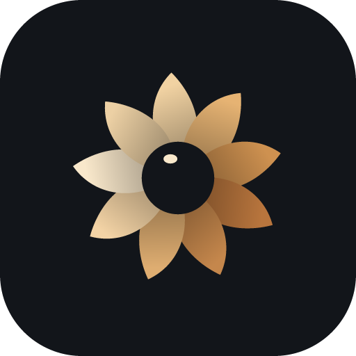

<p align="center">
  
</p>

<h1 align="center">IrisI</h1>
<p align="center"><strong>Stay with the light.</strong><br />An offline Android camera for deliberate image-making.</p>

<p align="center">
  
  
  
  
</p>

---

IrisI brings exposure, focus, monitoring and local media into one camera workspace.
Keep the viewfinder clear when you want to observe; reveal the controls when you
want to shape the image. Your captures stay on your device unless you share them.
The application declares **no Internet permission**.

**This is an actively developed, experimental camera—not a production release.**
Hardware support varies. A selected setting is a request, not proof of the file
the device produced. [Known limitations](KNOWN_LIMITATIONS.md) and
[test evidence](TEST_RESULTS.md) are part of the product documentation.

## The camera workspace

- **Intentional controls.** Exposure programs, shutter, ISO, focus and white balance;
  customizable HUD positions, function buttons and local presets.
- **Monitoring tools.** Scopes, zebras, focus peaking and preview looks. These are
  monitoring aids, not a claim of calibrated color or recorded vendor LOG.
- **Local workflow.** A searchable media library, favorites, sharing and development
  tools, without an account or cloud dependency for capture.
- **Material You.** Wallpaper colors on Android 12+, system light/dark mode and
  warm fallback palettes, with a dark optical preview.
- **Experimental capture paths.** DNG still sequences, recorded IrisI LOG 8-bit and
  device-dependent HLG, with explicit boundaries below.

## What is actually verified?

| Area | Current evidence and boundary |
| --- | --- |
| Standard video | A Pixel 7 Pro produced measured UHD AVC at ~24 fps after retrying without live analysis overlays. Not a universal quality/FPS guarantee. |
| IrisI LOG 8-bit | Two short physical-device clips passed custom signaling, sidecar, decoded-contrast and cadence checks. ISP-SDR-fed, **not RAW or 10-bit LOG**. |
| HLG | Short HEVC Main10 clips have HLG/BT.2020 tags; sampled decoded display RGB was nearly black. **Visual validation remains open.** |
| RAW sequences | Experimental sequential DNG stills in a ZIP, up to 60 frames / 10 seconds, requested rate capped at 10 fps. **Not a playable RAW movie.** |
| Reliability | Host and targeted device tests exist. Process death, long recording, thermal behavior and full lifecycle coverage are not established. |

If LOG finalization retains an original, the media library now offers a read-only
recovery review/share flow. It does not silently overwrite a clip or pretend the
retained original is repaired; its transfer tags may still be incorrect.

See the [validation index](docs/validation/README.md) for dated results. Test passes
describe their tested paths; they do not certify every camera mode.

## Build locally

Use Android Studio's bundled JBR (or JDK 21), Android SDK **36.1**, and the included
Gradle **9.3.1** wrapper. Android **7.0 / API 24** is the minimum runtime; actual
camera capabilities depend on the device.

```powershell
$env:JAVA_HOME = 'C:/Program Files/Android/Android Studio/jbr'
$env:ANDROID_HOME = "$env:LOCALAPPDATA/Android/Sdk"
.\gradlew.bat :app:testDebugUnitTest :app:assembleDebug --no-configuration-cache
```

The existing debug signing configuration expects `debug.keystore` at the repository
root. On a fresh clone, create a **local development key** (do not replace a key
already used for an installed app):

```text
keytool -genkeypair -keystore debug.keystore -storepass android -keypass android -alias androiddebugkey -keyalg RSA -keysize 2048 -validity 10000 -dname "CN=Android Debug,O=Android,C=US"
```

APK: `app/build/outputs/apk/debug/app-debug.apk`.
[Full build, install and device-testing instructions →](BUILD_AND_INSTALL.md)

## Project map

| Path | Purpose |
| --- | --- |
| [`app/src/main/java/com/example/camera`](app/src/main/java/com/example/camera) | Camera binding, image processing, recording and output validation |
| [`app/src/main/java/com/example/ui`](app/src/main/java/com/example/ui) | Compose viewfinder, controls, panels and theme |
| [`app/src/test`](app/src/test) / [`app/src/androidTest`](app/src/androidTest) | Host regressions and opt-in device checks |
| [`design`](design) | Editable design work, Penpot handoff and visual records |
| [`docs/brand`](docs/brand) | Identity assets and reproducible icon source |
| [`docs/validation`](docs/validation) | Dated evidence and explicit verification boundaries |

## Contributing

Start with [CONTRIBUTING.md](CONTRIBUTING.md). Useful contributions prove a small
behavior end-to-end: implementation, regression test, and an honest device result
where hardware matters. Do not report reference-format compatibility or camera
quality based solely on UI labels.

No license has been declared yet. Public source availability does not itself
grant a redistribution license; ask the maintainer before redistribution.
